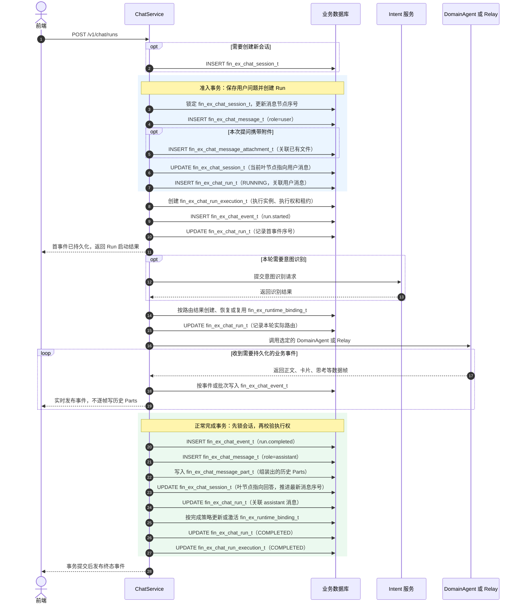

# Chat Run 主流程数据库写入时序

主线：前端通过 `POST /v1/chat/runs` 发起普通 `NEXT` 提问，使用 `FULL` 留存，DomainAgent 或 Relay 正常回答。图中均为[初始化 DDL](../../src/main/resources/db/init-20260718.sql) 中的完整物理表名。色块标出准入和正常完成两个事务；启动响应只表示首事件已持久化，不表示回答已经保存。

## 条件分支的写入

| 场景 | 与正常完成路径的区别 |
|---|---|
| 澄清、模糊候选、Ask User、拒答等待确认 | 在等待事务中，`fin_ex_chat_event_t` 写入 `run.waiting_user`，`fin_ex_chat_message_t` 和 `fin_ex_chat_message_part_t` 保存阶段性回答，新增 `fin_ex_chat_interaction_request_t`，`fin_ex_chat_run_t` 和 `fin_ex_chat_run_execution_t` 进入 `WAITING_USER`。用户提交后认领 Interaction 并创建新的 Run 和 Execution，不将原 Run 改回 `RUNNING`。 |
| DomainAgent 拒答后自动重新路由 | 需要取消原绑定时，在同一事务内将拒答事件写入 `fin_ex_chat_event_t`、将 `fin_ex_runtime_binding_t` 中的原绑定置为 `CANCELLED`。后续可在同一 Run 内重新路由，不因更换技能新增用户消息。 |
| DomainAgent 异步受理与回调 | 受理后 `fin_ex_chat_run_t` 保持 `RUNNING`，`fin_ex_chat_run_execution_t` 变为 `ASYNC_WAITING`。有效回调更新 `fin_ex_chat_message_t` 中的原 assistant，按结果处理 `fin_ex_chat_message_part_t` 和 `fin_ex_chat_event_t`，并收口原 Run 和 Execution。没有独立的异步任务表。 |
| Stop、失败、Watchdog | `fin_ex_chat_event_t` 保存对应终态事件，`fin_ex_chat_run_t` 和 `fin_ex_chat_run_execution_t` 更新终态。是否在 `fin_ex_chat_message_t` 保存部分回答取决于具体路径，不是每次失败都会新增 assistant。 |
| 意图记录、路由记忆和观测 | 启用意图记录后，符合条件的识别结果异步写入 `fin_ex_intent_recognition_t`；`fin_ex_route_memory_t` 按路由记忆规则写入。开启观测后，`fin_ex_turn_trace_t` 记录整轮问答，`fin_ex_agent_observation_t` 记录单次调用尝试。这些不是每轮必写的表。 |

上传文件和提问引用文件是两个操作：上传涉及 `fin_ex_uploaded_document_t`，提问时仅在 `fin_ex_chat_message_attachment_t` 写消息与文件的关联。

实时事件与历史 Parts 也不是一一对应：`FULL` 下，流中事件先写 `fin_ex_chat_event_t`，历史 Parts 在完成或进入等待时组装后写 `fin_ex_chat_message_part_t`。`no-store` 下仍保存必要控制记录，但不按图中的 `FULL` 路径保存真实业务正文和业务 Parts。
