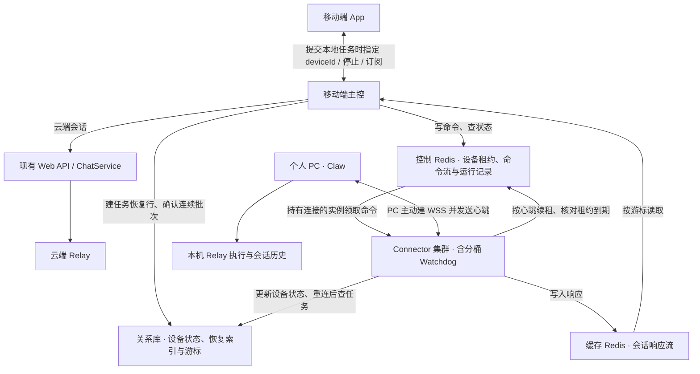
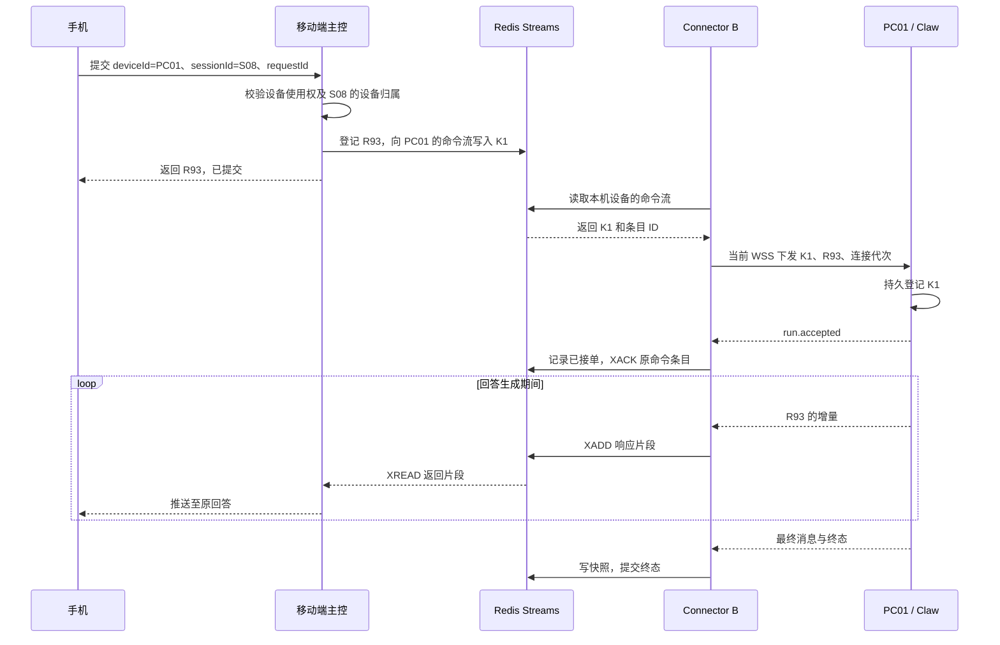
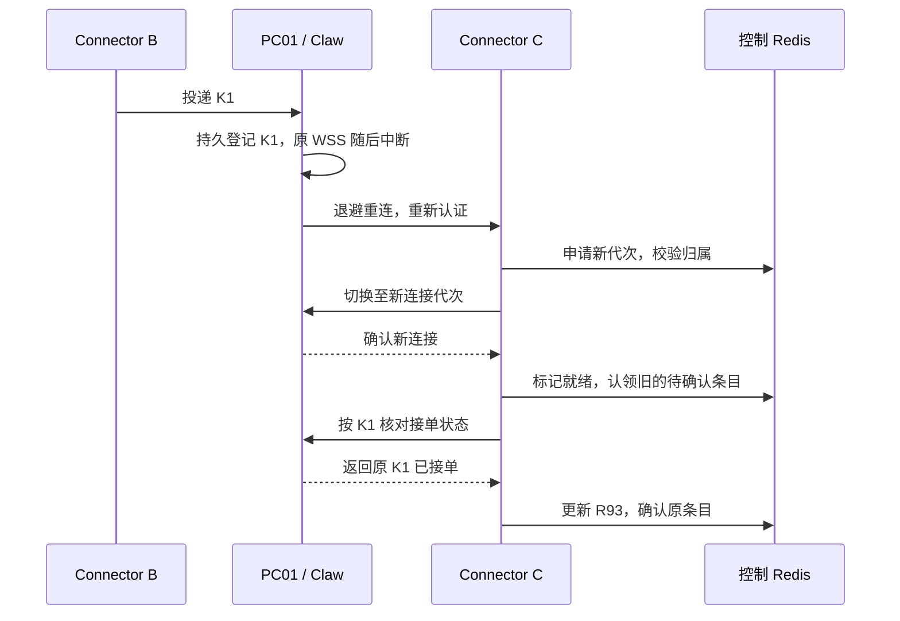
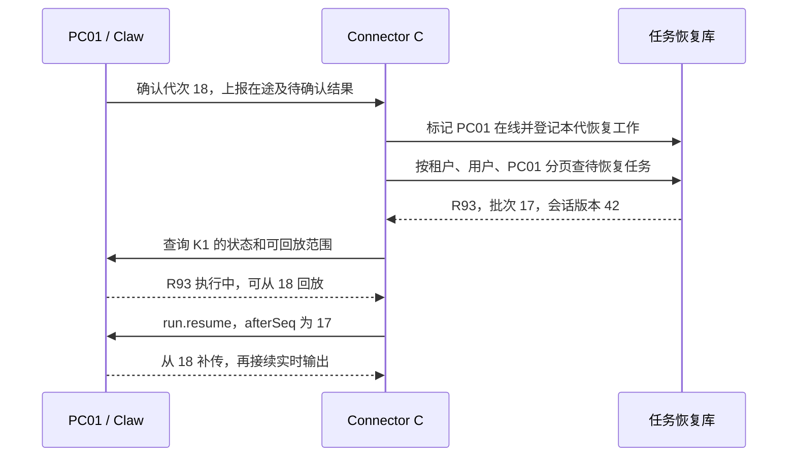
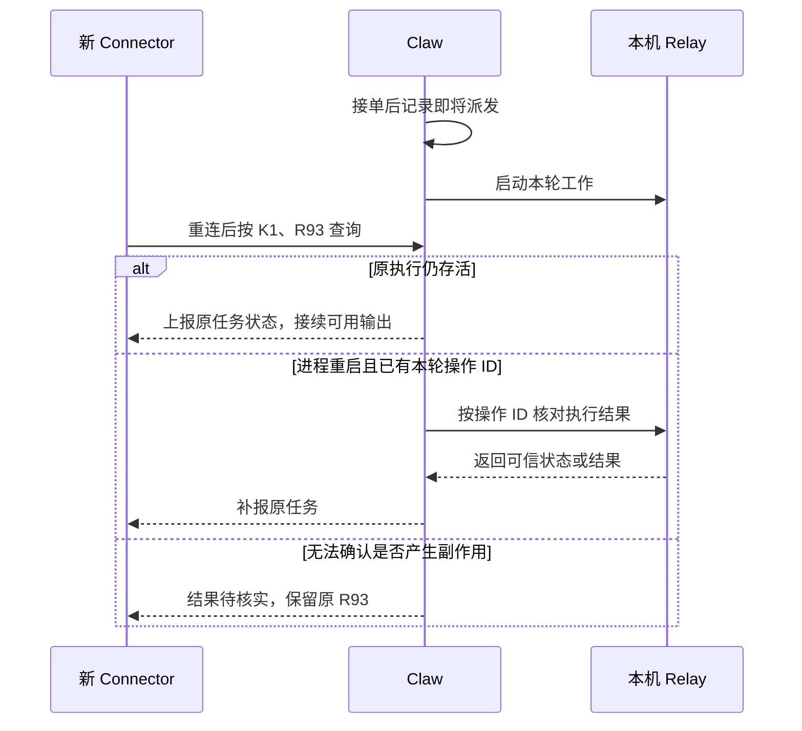
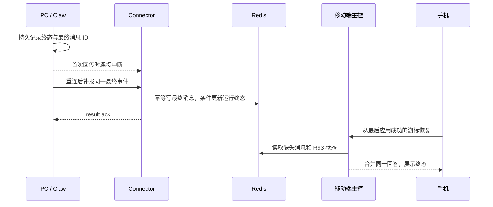

# 移动端聊天接入与 Claw 断线恢复设计

**方案评审稿 · 2026-11-27**　适用对象：移动端、服务端、桌面端及运维团队。

按一条请求阅读：[主控写入设备命令，Connector 定向投递](#41-主控写命令connector-怎样找到-pc01) → [Connector 写回答，主控推送给手机](#42-connector-写回答主控怎样推回-app)。

按一次重连阅读：[查哪些任务](#51-恢复任务表与设备级查询) → [如何对账并选择恢复来源](#52-新连接触发恢复) → [如何确认游标并接回实时输出](#53-补传确认与实时衔接)。[设备离线判定与 Watchdog](#54-设备离线判定与-watchdog) 说明 PC 尚未重连时如何更新设备状态。

## 1. 总体架构

移动端只访问 `FinanceEXMobileOrchestratorService`（下称主控）。会话选择云端时，主控调用现有 Web API，由 ChatService 编排云端 Relay。用户在 App 选择个人电脑后，每次提交本地任务都携带目标 `deviceId`。主控校验授权和会话归属，再按该 `deviceId` 将命令写入设备专属的 Redis Stream，由持有有效 WSS 的 `FinanceEXClientConnectorService` 实例（下称 Connector）投递。PC 主动出站建连，可处于家庭网络或企业内网。



**本次设计的重点是本地分支。** 主控负责用户授权、会话绑定、运行状态和手机侧输出；Connector 管理设备连接，持有新 WSS 的实例发起原任务核对，集群内的 Watchdog 接管掉线实例的设备巡检；Claw 作为首个接入客户端，负责本地接单、执行、去重和历史恢复。云端聊天仍走现有接口，可对移动端来源单独分配并发预算。设备心跳、重连及本地回答的实时流量由移动端链路承载。

**现有能力与建设范围。** 已确认 Claw 可按指定 Relay 会话恢复上下文。文中两个移动端服务、设备协议、PC 接单日志和结果确认均为拟建能力。涉及云端暂存正文时，本设计以“允许短期保存端到端密文”为条件，启用前需确认；第 8 节给出禁止云端保存副本时的行为。[现有 Web 接口](../frontend-integration.md) · [Relay 协议](../relay.md)

## 2. 会话、命令与状态的归属

一台电脑可以服务多个会话，一个会话可以有多轮运行。**App 指定本轮任务的设备，sessionId 标识要继续的对话。** 创建本地会话时，主控记录用户选择的设备。继续会话时，主控校验请求设备与记录一致。一轮提问生成一次运行，连接标识只在本次建连期间有效。为便于对照，下文用租户 T1、设备 PC01、会话 S08、运行 R93 举例。

| 标识或记录 | 产生与保存位置 | 作用 |
|---|---|---|
| `deviceId`、设备凭证 | 配对时登记到租户和账号；设备持有可撤销凭证 | App 每次提交本地任务都传 deviceId。主控校验设备使用权，Connector 验证发起 WSS 的设备身份。卸载、解绑或重配应使旧凭证失效。 |
| `sessionId → targetType / deviceId / runtimeSessionId` | 主控在建会话时保存 App 选择的目标。Claw 返回真实的本机 Relay 会话 ID | 续聊时校验请求的设备与会话记录一致，并找到原电脑上的对话上下文。问卷回复和停止也校验原任务归属。目标类型取 `CLOUD` 或 `DEVICE`，与现有表示请求来源的 `channel` 分开。 |
| `requestId / runId / commandId` | App 为一次提交生成 requestId；主控生成 runId、命令 ID | HTTP 重试复用 requestId；同一提问、停止和结果都引用原 runId；启动命令的重投复用原 commandId，停止使用自己的 commandId。 |
| `instanceId / connectionId / generation` | 控制 Redis 保存当前连接所有者、连接 ID、代次和带 TTL 的就绪租约；实际 WSS 在该 Connector 内存中 | 只有匹配当前连接的心跳能续租。设备从 B 迁至 C 时使用更高代次，原任务标识保持稳定。 |
| SQL 设备连接状态 | 每个租户及设备一行，记录 `ONLINE / OFFLINE` 与对应的实例、连接 ID、代次 | Connector 就绪时登记 ONLINE，正常关闭或 Watchdog 核实租约到期后条件更新 OFFLINE。该行支持查询及巡检，实时派发仍核对 Redis 与本机 WSS。 |
| 运行控制记录 | 控制 Redis，按设备分桶；保存投递期限、接单、取消意图、终态及幂等凭据 | 主控查询和 Connector 条件更新使用同一份权威运行状态。启用符合投递要求的持久化与故障恢复，内容缓存可独立清理。 |
| 任务恢复记录 | 主控关系库，按设备查询；保存任务批次游标和本机会话版本检查点 | 持有新 WSS 的 Connector 按设备读取候选，主控负责写入已确认的恢复进度。恢复前复核控制状态和 PC 接单记录，SQL 只存元数据。详见第 5.1 节。 |
| PC 接单与结果记录 | Claw 的本地受保护存储，按 commandId/runId 查询 | 记录接单、开始派发、可核对的 Relay 操作标识、待上报结果。去重有效期须覆盖命令可能重投的最长窗口。 |

**建议的最小协议。** App 支持创建或继续会话、提交提问、停止、查询运行状态及按游标读事件。主控按已鉴权的租户和用户解析绑定，在提交、订阅、历史读取和停止时复核归属。WSS 命令包括 `run.start`、`run.stop`、`run.status`；设备事件包括 `run.accepted`、`message.delta`、`message.final` 及运行终态。重连握手协商批次回放能力，新增的 run.resume、session.resume 和 batch.ack 见第 5.2、5.3 节。Claw 写入本地接单记录后才发 `run.accepted`，它表明 PC 已承担执行责任。执行成功以该 run 的终态为准。

## 3. Redis Streams 如何选中正确的 Connector

**主控按 App 指定并通过授权校验的 deviceId 选设备 key，Connector 读取本机就绪设备的 key。** 按已认证的租户和通过校验的设备标识算固定桶号。PC01 的命令流例如 `cmd:{b07}:T1:PC01`，租约和控制记录使用同一哈希标签。由此可在同一 Redis Cluster 槽内完成条件更新和批读。

1. **注册。** PC01 连到 B。B 验证配对关系，原子取得新代次，在本机登记 WSS 并确保该设备的消费组存在。Claw 确认切换到新代次后，B 比对租约并标记 READY，按代次将 SQL 设备行登记为 ONLINE，再将 PC01 加入自己的读取列表。未完成的登记按原连接重试，低代次及已关闭的同代连接不得覆盖设备行。续租、释放、确认派发均校验当前连接身份；代次在租约过期后仍须防止复用。
2. **提交。** App 随每次本地任务提交 `deviceId=PC01`。主控校验用户有权访问 PC01 和会话 S08，并核对 S08 的设备记录。设备不一致时返回冲突，结束本次提交。校验通过后按 `(租户、用户、会话、requestId)` 去重。同一请求重试返回原 R93；相同幂等键绑定不同请求应拒绝。首次提交，先在关系库建立任务恢复行并预留稳定标识，再将运行控制记录、请求映射和 `run.start` 在控制 Redis 同槽登记。写入回执超时时先查原映射，再决定是否补投同一命令。允许密文暂存时，先写有期限的加密请求对象，再将不可猜测的 requestRef 随命令入流。孤立对象到期清理；对象提前缺失时先核对设备是否已接单，明确未接单则通知重新提交。
3. **定向读取。** B 按本机设备表分桶，有限阻塞、分批轮转；C 没有 PC01 的有效连接，就不把它放进读取列表。获得条目后 B 再校验租约、启动期限、取消意图，经实际 WSS 投递，Claw 再校验代次。单个共享命令流上的消费组会在消费者间分配条目，无法按条目里的 deviceId 自动找到持有 WSS 的实例。

```text
XGROUP CREATE cmd:{b07}:T1:PC01 dispatch 0-0 MKSTREAM
XADD cmd:{b07}:T1:PC01 * type run.start commandId K1 runId R93 requestRef Q1 expiresAtMs <deadlineMs>
XREADGROUP GROUP dispatch B-boot7 COUNT 16 BLOCK 200 STREAMS cmd:{b07}:T1:PC01 >
```

首次从 `0-0` 建组，可读到建组前已写入的命令；重连时复用既有组。批读多台设备时，在 `STREAMS` 后列出本机同槽各 key，再为每条流给一个 `>`。每台设备有独立的待确认列表（PEL）。每条流独立建同名组，多个设备共享批读器。未消费或仍可能重投的命令保留到完成对账，避免裁剪后 PEL 只剩条目 ID。Redis 故障转移后应重新确认租约及 PC 当前连接，无法确认时暂停新启动。[消费组读取](https://redis.io/docs/latest/commands/xreadgroup/) · [Redis Cluster 哈希槽](https://redis.io/docs/latest/operate/oss_and_stack/reference/cluster-spec/)

## 4. 正常请求与流式回传

主控提交成功后可立即返回 runId。接单回执到达时，Connector 在控制 Redis 同槽校验代次、记录接单并 XACK。增量可随时回传，完成时另行确认结果。



主控在投递前取得响应流的起读位置，或使用 App 已确认的游标。它可以在运行期间持续读取。提交后直接从 `$` 开始可能跳过首帧。每台手机按自己的位置读 `reply:<tenant>:<sessionId>`；同一会话内用 runId 归入对应回答，并用稳定的 eventId 或 `runId + seq` 去重。App 切后台只结束订阅，可经任一主控实例重新接入。[Redis XREAD](https://redis.io/docs/latest/commands/xread/)

## 4.1 主控写命令，Connector 怎样找到 PC01

假设用户在手机上选择 PC01，并在该设备上的会话 S08 中继续提问。PC01 的 WSS 在 B，PC02 的 WSS 在 C。下面两条流足以跟踪这次请求。示例使用交互式 redis-cli 语法；条目 ID 为样例，运行时由 Redis 生成。

| Stream key | 谁写 | 谁读 | 对应的下一跳 |
|---|---|---|---|
| `cmd:{b07}:T1:PC01` | 受理提问的主控 | B 用 XREADGROUP 领取 | B 在本机查 PC01 的 WSS，把命令发给 Claw |
| `reply:T1:S08` | 收到 Claw 回包的 Connector | 承载手机订阅的主控用 XREAD 读取 | 主控取出 R93 的事件，写入该手机的 HTTP 响应流 |

**第一步 · Connector 在设备上线时启动读取。** B 完成设备认证并建组后，维护 `PC01 → {generation: 17, wsSession: ws17}`，其读取器循环执行下列命令。空闲时最多等 1 秒便返回，B 可更新设备列表后再读。C 的读取列表只有 PC02；即使两个实例都使用名为 dispatch 的组，两个组也分属不同的设备 key。

```text
XREADGROUP GROUP dispatch B-boot7 COUNT 16 BLOCK 1000 STREAMS cmd:{b07}:T1:PC01 >
```

**第二步 · 主控按请求中的 deviceId 选设备 key。** 手机调用拟议接口 `POST /mobile/chat/sessions/S08/runs`，请求体携带 `deviceId=PC01`、requestId 和加密提问。主控校验设备使用权，并确认路径中的 S08 属于当前用户及 PC01。先用第一条命令取得响应起点，假设为空则记为 `0-0`；再向 PC01 的 key 投递命令。Q1 指向已保存、有授权和期限的请求密文。接口成功时返回 `202 {runId: "R93", after: "0-0"}`；重复提交返回原 R93 和原起点。这里仅列出操作 Stream 的部分，控制记录的条件更新见第 3 节。

```text
XREVRANGE reply:T1:S08 + - COUNT 1
XADD cmd:{b07}:T1:PC01 * type run.start commandId K1 runId R93 sessionId S08 requestRef Q1
```

**第三步 · B 定向投递并确认。** 假设 XADD 返回 `1000-0`。上面 B 的阻塞读此时返回同一条目 ID 和 K1、R93、S08、Q1；C 继续等待 PC02 的命令。B 从**返回的流 key**定位 PC01，复核有效租约，从 Q1 取得密文，用 `ws17.send(...)` 下发 K1 和负载。Claw 本地持久接单并回传 `run.accepted(K1,R93)` 后，B 才记录接单并确认原条目。XACK 使用 **Redis 条目 ID**。

```text
XACK cmd:{b07}:T1:PC01 dispatch 1000-0
```

## 4.2 Connector 写回答，主控怎样推回 App

**第四步 · Connector 把 WSS 回包写入会话流。** Claw 在 ws17 回传 `R93 / seq=1`。B 从 K1 投递时保存的可信运行绑定中解析 `R93 → T1 / S08`；即使设备迁到 C，也能按同一运行记录核对。B 把获准暂存的密文 D1 写入 S08 的响应流。第二个片段 D2 到达后，仍写同一个 key。

```text
XADD reply:T1:S08 * type message.delta runId R93 seq 1 ciphertext D1
XADD reply:T1:S08 * type message.delta runId R93 seq 2 ciphertext D2
```

假设两次分别返回 `2000-0` 和 `2000-1`。序号 1、2 属于 Claw 的 R93；两个长 ID 属于 Redis 的 S08 响应流。重报时使用稳定事件 ID 或 runId + seq 去重。

**第五步 · 主控把 Redis 条目映射为手机事件。** 手机拿到 202 后，通过拟议接口 `GET /mobile/chat/runs/R93/events?after=0-0` 建立 SSE。承接 GET 的主控可以与承接 POST 的实例不同。它校验用户对 R93 的权限，查出 S08，循环执行 XREAD。已存在的条目立即返回；暂无新条目时阻塞等待。主控按返回顺序处理，筛出 R93 的事件，将每条写入这次 GET 对应的 SSE 连接并立即 flush。

```text
XREAD COUNT 64 BLOCK 1000 STREAMS reply:T1:S08 0-0
```

第一条 Redis 记录转成以下 SSE 帧，帧末有空行。手机解密 D1，显示到 R93 对应的回答中。即使 D1 在手机建立 SSE 前已写入，只要仍在保留窗口，首次读仍能取到。

```text
id: 2000-0
event: message.delta
data: {"runId":"R93","seq":1,"ciphertext":"D1"}

```

**第六步 · 继续读取或恢复。** 主控在一次连接内按最后检查过的 Stream ID 向后读；手机记录最后实际应用的 SSE id。假设手机只处理完 D1 就断网，重连时提交 `after=2000-0`。新的主控执行下面的读取，返回其后的 D2。多台获授权手机各用自己的游标，响应侧采用普通 XREAD。窗口被裁剪时进入第 7 节的快照补读流程。

```text
XREAD COUNT 64 BLOCK 1000 STREAMS reply:T1:S08 2000-0
```

回答结束时，Connector 先按留存策略写最终消息快照，再提交 R93 的权威终态，并把带稳定标识的完成通知写入响应流，失败时按同一标识补发。主控将 `run.completed` 作为 SSE 事件发给 App，结束该运行的订阅。若完成通知暂缺，手机仍可按 runId 向主控查状态。[Redis XREAD](https://redis.io/docs/latest/commands/xread/) · [SSE 事件与重连标识](https://html.spec.whatwg.org/multipage/server-sent-events.html#the-last-event-id-header)

## 5. 接单前断线与连接交接

首版建议**仅在线启动**。发送前已知 PC 离线，直接提示“电脑离线，请上线后重试”。在线检查与真正投递之间仍可能断线，每条启动命令都带 `expiresAt`。Claw 先按 commandId 查询接单记录，仅在首次接单前校验期限，防止网络延迟使过期命令被执行。



| 中断位置 | 恢复与手机状态 |
|---|---|
| 手机提交或主控写入超时 | 使用原 requestId 查回原 runId。只有确定未登记时才补建，页面保留一条提问。 |
| B 已领取，明确尚未送出 | C 接管后，设备可用且命令有效才首次派发；已过期并核实未接单则标记“未启动，已过期”。 |
| B 已写 WSS，或 Claw 的接单回执丢失 | 显示“接单状态待确认”。C 按原 commandId 查询或幂等重投。已登记的命令返回原结果；缺少可信记录时继续核对，不以超时直接判失败。 |

新代次 READY 后，持有新 WSS 的 C 接管设备命令 PEL，同时按该设备查询任务恢复库。Claw 用心跳探测失联，以带随机抖动的指数退避重连统一入口。C 用 `XAUTOCLAIM` 按游标接管达到最小空闲时间的 PEL，周期性复查较新的 pending，另用 `>` 收新命令。**认领只能改变 Redis 中的消费归属，撤不回 B 已发出的帧。** Claw 以当前连接代次拦截旧帧，跨连接、跨进程重启以原 commandId 去重。对同一 run 先核对取消意图和待确认命令，再释放新启动；其余设备可继续处理。[Redis XAUTOCLAIM](https://redis.io/docs/latest/commands/xautoclaim/)

## 5.1 恢复任务表与设备级查询

**启动命令在接单后已经 XACK，执行中的任务仍需在 PC 重连时被找到。** 主控在关系库维护按设备可查询的任务恢复记录，保留到任务终态及结果交付均得到确认。命令领取和接管继续按第 3 节处理。

| 存储位置 | 关键字段 | 写入和读取规则 |
|---|---|---|
| 任务恢复行，每个 run 一行 | tenantId、ownerUserId、deviceId、runId、startCommandId、runtimeSessionId、needsReconcile、resultDeliveryState | 当前 Connector 按可信设备绑定找到执行未结束或终态结果待确认的 run。首次尚未取得 runtimeSessionId 时允许为空。 |
| 同一任务行的两个检查点 | lastAckedBatchSeq、lastConfirmedVersion | 前者是此 run 已确认的最高连续批次，初始为 0；后者是上次为该 run 对账时，其本机会话已确认的历史版本，可为空。两者不能换算。 |
| 本机会话绑定 | tenantId、deviceId、runtimeSessionId、lastConfirmedVersion；关联 run 与本机 turnId 或 messageId | 会话行维护该会话公共的已同步版本。任务行保存本轮检查点。按会话串行补历史，按明确映射归入各轮；缺少归属时保留待核实。 |
| PC 本地接单记录 | runId、commandId、当前状态、可回放批次范围、最终事件 ID 和回执情况 | 重连时上报仍在执行和终态未获回执的任务。批次补传能力需由 Claw 新增；跨 PC 进程重启时仍要补批次，应将序号与批次在本地一起持久保存。 |

**候选索引先于派发建立。** 主控按第 3 节的幂等键先建立 needsReconcile=true 的恢复行，固定 runId、commandId，再将同一标识写控制 Redis。SQL 失败则暂不投递；SQL 成功后主控中断，可查回原行并核对命令去向。孤立的恢复行只代表一次提交意图，不能用作重新启动的依据。控制 Redis 继续维护运行和取消事实，关系库维护已确认的恢复进度；两者间按稳定 ID 幂等重试，不要求跨库事务。

**查询入口。** 持有新连接的 Connector 在 READY 后直接读取恢复库，用设备凭证绑定的租户、用户和设备作查询条件。主控继续负责写入任务恢复行和确认游标。建议索引为 `(tenant_id, owner_user_id, device_id, needs_reconcile, run_id)`。按 runId 分页，单设备合并重复扫描；不同设备可并行。

```sql
SELECT run_id, start_command_id, runtime_session_id, last_acked_batch_seq,
       last_confirmed_version, result_delivery_state
FROM mobile_task_recovery
WHERE tenant_id = :tenant AND owner_user_id = :owner AND device_id = :device
  AND needs_reconcile = TRUE AND run_id > :page_after
ORDER BY run_id LIMIT :page_size;
```

表名和列名是拟议契约。第一页省略分页下界。仅在终态和所需交付均已确认后清除 needsReconcile；索引更新滞后至多多查一行。Claw 主动上报的未确认最终事件即使不在候选列表中，也按绑定核对并重发已有确认。

## 5.2 新连接触发恢复

示例：PC01 从 B 重连到 C，连接代次升至 18。R93 的启动命令早已确认；关系库记着已收批次 17、本机会话版本 42。恢复目标是继续交付 R93 的输出。



**可靠触发。** C 把本代设备 ONLINE 与待扫描工作在同一 SQL 事务登记。同一代重复 READY 合并并保留原检查点。C 在每轮分页及向 PC 发命令前复核当前租约与 WSS，扫描中断可按设备重新分页。若 SQL 登记失败，仍持有效租约的 C 重试登记；C 退出则由设备下一次重连的持有者接手。主控继续在确认批次时校验当前代次，旧连接的迟到回包不得推进游标。

| 核对原 commandId 的结果 | 发送给 Claw 的动作 |
|---|---|
| 明确从未接单，或尚无本机 session ID | 核对启动命令的期限、取消意图和原 PC 接单记录。仅明确未接单且仍允许启动时，才投递同一启动命令。 |
| 原执行存活，保留范围覆盖第 18 批 | `run.resume(runId=R93, afterSeq=17)`。使用原 run 与输出序列；恢复请求可重复，不得再向 Relay 发起原提问。 |
| 批次有缺口，本机会话可读 | Claw 返回 `batch.gap`。C 经当前 WSS 请求 `session.resume(runtimeSessionId, sinceVersion=42)`，按第 5.3 节补持久消息；PC 未声明批次回放能力时直接走此路径。 |
| 已完成、结果尚未确认 | 优先补同一最终事件和可回读消息；云端已提交则返回原 result.ack。 |
| 操作可能执行，缺少可信结果 | 保留“结果待核实”。用户已要求停止时优先核对取消意图，执行中断及迟到终态按第 6、7 节处理。 |

## 5.3 补传确认与实时衔接

**推进条件。** Claw 对同一 run 的输出批次连续编号，重连后沿用旧序号。Connector 先将已授权的批次幂等写入响应窗口，再向主控报告已写入的区间。主控在 SQL 事务内核对设备最新代次、旧游标及批次连续性，事务成功后才经 Connector 发 `batch.ack(ackThrough=N)`。可合并确认多个连续批次。Claw 在 ACK 前保留对应批次；若达到本地保留上限，应上报真实可回放范围。

| 断点 | 应有行为 |
|---|---|
| SQL 为 17，先收到 19 | 暂存或标记 19，确认仍停在 17。18 补齐且两批均已写入后，才推进到 19。 |
| 18 已写 Redis，SQL 更新失败 | 从 17 恢复，按 R93 + 18 去重。若 SQL 已提交、给 PC 的 ACK 丢失，则读回已提交的连续水位并重发 ACK。 |
| 手机游标落后且 Redis 窗口已过 | 服务端确认水位只证明当时收过这些批次。按手机缺口回读授权快照或 PC 历史；不能以服务端已确认 19 推断手机已显示 19。 |

**按版本恢复历史。** 外层 session.resume 由 Claw 转为本机 Relay 的 `config(sessionMode=resume, sessionId=...)`。协商增量并收到 `session-init` 后，发 `get-incremental-events(since_version=42)`，按会话版本和消息标识去重。整页已校验、持久事件处理完成后，以协议返回的页边界推进；多页按 `raw_max_version_id` 续查。恢复同一会话的多个候选任务时，按各自缺口从最早所需版本读一次，并按本机 turn/message 映射分发。当前任务检查点与会话进度在同一 SQL 事务更新；缺失的早期消息或无法归属的结果仍可单独回查。会话版本无法还原无 version_id 的瞬时 token，也不能鉴定工具是否执行。[Relay 增量协议](../relay.md)

**从回放转回实时。** 在 Claw 端先订阅并缓冲该 run 的新输出，固定补读边界 H；回放至 H 后，按序排放缓冲中大于 H 的批次。若改用草稿快照，快照须携带 runId、messageId 和在同一时点取得的 coversThroughSeq；手机替换草稿后只追加该水位之后的批次。无可信覆盖水位时等待可核实的完整消息替换草稿，并提示“部分片段无法恢复”。禁止云端内容副本时，仅控制元数据可入库；应由获准的实时路径提供交付确认，不能仅凭元数据写入就声称正文可补读。

## 5.4 设备离线判定与 Watchdog

**心跳与正常关闭。** PC01 主动经 WSS 向 C 发 `ping`。C 在控制 Redis 原子比对租户、设备及租约中的 `ownerInstanceId / connectionId / generation`，全部匹配才延长 TTL 并回 `pong`。续租只能延长尚存的本代租约。租约已过期或已由新连接持有时，C 停止为旧连接续租并停止投递，Claw 重新注册。收到正常 WSS Close 后，C 立即停止派发，条件释放本代租约，并按同一连接身份将 SQL 的 ONLINE 改为 OFFLINE。

**异常失联。** Watchdog 运行在 `FinanceEXClientConnectorService` 内。存活实例按桶认领巡检工作，定期续期。巡检实例退出后，其他实例可在该桶的认领到期后接手，即使持有 WSS 的实例也已退出，巡检仍能继续。每轮按桶分页读取 SQL 的 ONLINE 行，按租户和设备键翻页，并向 Redis 主节点批量核对租约。有效租约或更高代次表示设备已有连接。仅在 Redis 健康且能确认原租约到期时，才执行下面的条件更新。同一行重复巡检或设备已重连，旧更新均命中 0 行。旧代次不能重新登记为 ONLINE。

```sql
UPDATE mobile_device_connection
SET status = 'OFFLINE', offline_detected_at = CURRENT_TIMESTAMP
WHERE tenant_id = :tenant AND device_id = :device AND owner_instance_id = :owner
  AND connection_id = :conn AND generation = :gen AND status = 'ONLINE';
```

**检测窗口。** 示例取心跳 10 秒、租约 TTL 30 秒、每桶巡检间隔 5 秒。以最后一次成功续租为零点；正常负载下在约第 30–35 秒发现过期，实际写入还受分页积压和数据库延迟影响。Redis 超时、主从切换或刚恢复时，巡检暂停下线更新并告警；待主节点稳定、给存活连接重新确认的完整租约窗口，再逐桶复查。SQL 下线只更新设备状态；PC 尚未建立新 WSS 时保持原任务状态，等新连接就绪后由持有实例按第 5.2 节核对。

## 6. 执行中断线与安全重试

WSS 中断时，本机 Relay 可能仍在生成回答。主控保留原 runId 和上次确认的运行状态，App 保留已收到的部分，并显示“设备断开，正在核对进度”。断线本身不触发重新提问，也不切到另一台电脑或云端 Relay。



| PC 上能确认的事实 | 恢复动作 |
|---|---|
| 本地状态为“已接单，尚未派发” | 核对取消意图和适用的执行期限，恢复同一条本地任务。调用 Relay 前先持久记录“开始派发”。 |
| Relay 已经接收或可能已接收，PC 随后崩溃 | 先查本地或下游操作记录。无法确认且工具可能产生副作用时标为“结果待核实”。到对账期限结束自动等待；可验证的迟到结果补回原 run。 |
| 用户在 PC 离线时点击停止 | 记录取消意图，显示“停止待确认”。Claw 对同一本机会话串行校验活动 runId 与中断操作；旧 stop 只返回原状态。上轮执行结果未明时暂停复用该会话，防止一次会话级中断误停新一轮。 |

**恢复会话与恢复计算有不同条件。** 用已知 runtimeSessionId 执行 resume，再按增量协议补读已保存的消息。历史记录本身无法证明工具未执行或原计算仍存活；现有 ChatService 声明了增量能力，移动端需实现补读。[Relay 历史协议](../relay.md) · [现有适配器](../agent-runtime-forwarding.md#4-relay-websocket) · [现有恢复边界](chat-streaming-and-resume.md)

## 7. 返回结果时断线与手机续读

**Claw 保留待上报的终态与可回读的最终消息，直到收到结果确认。** PC 接单确认、Redis 命令 XACK、结果确认、手机消费游标是四个独立动作。最终事件的 ID 在重传中保持不变。



| 故障点 | 处理与用户可见结果 |
|---|---|
| PC 完成了，结果尚未到 Connector | PC 重连后重发同一最终事件。手机保留部分内容或“等待结果”，不再启动新任务。 |
| 最终正文写入后，终态写失败，或结果确认丢失 | Connector 对正文用稳定消息 ID 去重，终态以条件更新提交。两次写入可独立重试。密文模式在所需写入均确认后回 `result.ack`；仅控制模式确认终态及 PC 本地可回读标识。已提交的同一事件回原确认；相互矛盾的终态转入对账。 |
| 手机或主控切换实例 | 用 App 最后**成功应用**的响应 Stream ID 补读。记录缓存窗口代次与裁剪水位；游标过旧或 key 被淘汰、重建时返回“窗口已过”，优先读取授权的完整消息快照；缓存也过期时等 Claw 上线，再恢复原会话。 |

**按链路区分标识。** 设备重连使用任务批次 seq 和本机会话 version_id；手机续读使用响应 Stream ID；命令 Stream ID 仅供 Connector 认领和 XACK。增量分页有 `has_more` 时按协议给出的 `raw_max_version_id` 续查。逐 token、部分工具流和心跳等临时事件无法逐帧补回；手机用本地持久化的完整消息替换中断草稿。[Relay 分页和事件范围](../relay.md)

## 8. 离线历史、隐私与容量

PC 是本地会话历史的权威来源。手机获准后可按账号和设备加密缓存近期记录；PC 离线时显示上次同步时间。新手机或清除缓存的手机，只能显示当时仍可授权读取的副本。移动端创建的会话可由主控索引发现；发现仅在 PC 上创建的其他会话，需另外提供设备端的会话目录同步。

| 数据 | 建议边界 |
|---|---|
| 云端控制面 | 仅保存租户、账号、绑定、时刻、运行状态和幂等凭据等必要元数据。标题、摘要、提问、工具结果、回答一律按内容处理。设备凭证可撤销；禁止将 Web 登录 Cookie 透传到个人 PC。 |
| 云端短期窗口 | 仅在允许云端保存短时密文时启用。提问由 App 加密给已配对 PC；回答由 Claw 加密给已授权移动端。密钥留在端上；日志、链路追踪、死信、快照、AOF 和备份须遵守同一策略。若禁止任何云端内容副本，纯 Streams 仅承载控制或引用；正文需另设获准的实时通道，离线正文由手机已有缓存提供。 |
| 缓存控制 | 增量流示例保留 2 分钟；独立的最终消息缓存保留 30 分钟，每用户最多 20 条或 2 MiB。最终快照、用户索引和字节计量放同一用户槽内原子更新。按时裁剪、到期拒读，空闲 key 设 TTL。单条超限时只存可回 PC 读取的标识。 |

**按 1 万用户规划。** 在线 PC 数决定 WSS 与心跳开销，同时生成数、合并后每秒片段数和实际密文字节数决定写入吞吐。假设 1,000 个活跃 run 各产生 5 个 1 KiB 片段/秒，2 分钟片段约 0.57 GiB，30 分钟约 8.58 GiB；另存 1 万用户各 20 条、每条 8 KiB 的回答约 1.53 GiB。以上是单份载荷，需另测键与索引、内存碎片、连接缓冲及复制开销。

**64 GB 主节点是压测候选规格。** 命令与权威控制记录使用独立于可淘汰响应缓存的资源预算，限制移动端调用 Web API 的并发。缓存压力下优先缩短补读窗口，并向客户端返回缺口。控制层写入失败时返回未受理或状态待确认，不能把请求展示为设备已接单。监控内存、淘汰与写入拒绝，同时压测 Web 首响应 P95。[Redis 裁剪](https://redis.io/docs/latest/commands/xtrim/) · [内存与淘汰](https://redis.io/docs/latest/develop/reference/eviction/)

## 9. 验收与待确认决策

最小验证环境为两个主控实例、两个 Connector、同一用户的两台 PC，以及第二个测试账号。使用可计数的本地测试操作、可控制的断链点和不含个人内容的测试载荷；分别记录请求、接单、执行和终态的次数。

| 场景 | 注入方式 | 验收结果 |
|---|---|---|
| 指定设备及账号隔离 | 手机选择 PC01，让 PC02 同时在线；以第二个账号读取或停止原任务 | 只有 PC01 收到命令；越权请求拒绝；同 requestId 重试只返回原 run。 |
| 接单前失联及过期 | 先离线再提交；另一次在 B 领取后、写 WSS 前退出 | 明确离线时提示未启动；允许期内 C 接管原命令；过期命令在 PC 上线后不启动。 |
| 接单回执丢失 | PC 持久接单后、B 执行 XACK 前退出；PC 重连 C | C 取得原 PEL 条目；PC 按 K1 返回已接单；实际执行一次，迟到的 B 清理不影响 C。 |
| 执行中进程退出 | 分别在调用 Relay 前和可能产生副作用后终止 Claw | 确定尚未派发的任务可恢复；结果不明时报告待核实，原输入不会被自动重新执行。 |
| 结果与终态部分成功 | 分别丢弃最终消息、终态写入回执、result.ack；期间切换主控 | 以同一最终事件补报；手机只有一份完整回答；控制状态只提交一次。 |
| 心跳、关闭与连接换代 | 正常发送 ping 后关闭 WSS；另使旧 B 的延迟 Close 或扫描结果晚于 C 登记 ONLINE | 当前连接正常关闭即条件下线；旧代次续租、关闭与下线更新均不覆盖 C。 |
| 异常离线与巡检接管 | 对在线 PC 断网，同时退出原持有节点或巡检节点；另注入 Redis 超时及主从切换 | 同伴接管巡检桶；权威租约确认到期后仅匹配连接转 OFFLINE。Redis 状态不明时不批量下线。原任务保持，PC 重连前无恢复派发。 |
| 已接单任务的重连扫描 | 启动已 XACK 再断线；重复 READY，并令旧代次迟到 | 只查该租户、设备的开放任务及结果待交付任务，原 run 可恢复，旧代次不能推进游标。 |
| 批次缺口和跨存储中断 | 先到 19 再到 18；分别在缓存写入和 SQL 提交后断开 | 连续水位从 17 推至 19；重复批次无重影，ACK 可补发。PC 批次过期时按版本补回本轮消息，实时切换无重复追加。 |
| 停止与窗口过期 | 手机离线重进；PC 离线发 stop；查询已裁剪游标 | 手机断开不取消任务；区分停止待确认与已停止；窗口缺口可见，按授权快照或 PC 历史恢复。 |
| 规模与故障隔离 | 混合在线空闲、执行高峰、Connector 集中重连、缓存满载 | 观察就绪设备数、PEL 数量和最老年龄、接单 P95、重复命中、待核实运行、终态延迟及 Web P95；控制容量不被回答缓存耗尽。 |

**Redis 命令验证。** 在隔离的 Redis 7.4.9 中向 PC01 写入 K1，B 读取 PC01 得到 K1，C 读取 PC02 返回空。PC01 的待确认数为 1，新消费者可认领，XACK 后为 0。在 S08 写入两条响应，从第一条的 ID 重读只收到第二条，从第二条的 ID 再读返回空。本次验证范围为 Streams 命令语义。

**接入前确认。** 产品与隐私负责人确定云端密文及手机本地留存范围、到期与删除行为。桌面团队验证接单日志、跨重启批次回放、原任务查询、历史版本协议及终态补报。平台团队验证 Redis 版本与持久化、控制集群故障转移、WSS 网关保活、租约时长、PEL 接管阈值、启动截止和实际并发。文中的阈值与容量是验证起点，未做实机联调或生产压测。
