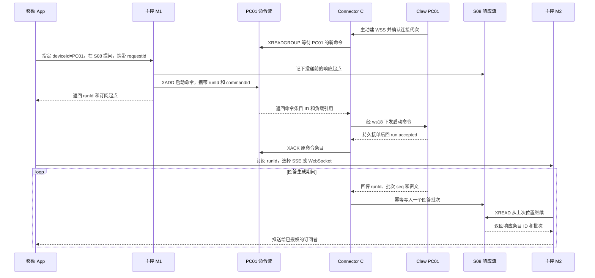

# 移动端访问本地 Claw：Redis Streams 整体流程

手机在每次提交本地任务时都显式发送目标 `deviceId`。例如，租户 `T1` 的用户选择电脑 `PC01`，在会话 `S08` 中提问。主控用 `deviceId=PC01` 选设备命令流，用 `sessionId=S08` 找到这段对话的上下文和响应流。主控实例 M1 接收提问，M2 承接 App 的订阅。Connector C 持有 PC01 的连接 `ws18`。M1、M2 均属于 `FinanceEXMobileOrchestratorService`，B、C、D 均属于 `FinanceEXClientConnectorService`。这些是拟建移动端服务的交互约定。云端会话仍走 Web API、ChatService 和云端 Relay。[总体设计](mobile-claw-routing-and-recovery.md)

## 两条流由谁写、谁读

| Redis 记录 | 写入方 | 读取方 | 用途 |
|---|---|---|---|
| 设备命令流 `cmd:{b07}:T1:PC01` | M1 用 `XADD` 写启动或停止命令 | 持有 PC01 就绪 WSS 的 C 用 `XREADGROUP` 领取 | 一台设备一条流。C 从流名解析目标设备，在本机查到对应 WSS。 |
| 会话响应流 `reply:T1:S08` | 收到 Claw 回包的 C 按批次 `XADD` | 接受 App 订阅的 M2 用普通 `XREAD` 续读 | 一个会话可有多轮回答，M2 按 `runId` 过滤。各订阅保有独立游标。 |

`lease:{b07}:T1:PC01` 是带 TTL 的连接租约，记录当前实例、连接 ID 和代次。实际 WSS 对象在 C 的内存中。主控和 Connector 按同一规则从租户与设备算出桶号。相同的 `{b07}` 使相关键落入同一 Redis Cluster 哈希槽。即使两台设备同桶，它们也各有自己的命令流。C 可以一次批读本机持有且同槽的多条设备流。[Redis Cluster 哈希标签](https://redis.io/docs/latest/operate/oss_and_stack/reference/cluster-spec/#hash-tags)

批次已写入的区间可通过内部控制通知送给主控，只携带设备代次、运行标识和序号范围。设备重连就绪时，当前 Connector 直接查 SQL 恢复原任务。

## 一次提问如何往返



**1. 设备上线，C 先等命令。** PC01 主动建连、认证并确认代次后，C 登记 Redis 租约和 SQL 在线状态，在本机保存 `(T1, PC01) → ws18`。同一设备流第一次使用时从 `0-0` 建组，后续连接复用该组。每次 Connector 进程启动使用独立消费者名。以下是交互式 redis-cli 示例，命令由各步骤注明的服务分别执行。

```redis
XGROUP CREATE cmd:{b07}:T1:PC01 dispatch 0-0 MKSTREAM
XREADGROUP GROUP dispatch C-boot1 COUNT 16 BLOCK 1000 STREAMS cmd:{b07}:T1:PC01 >
```

`STREAMS` 后列的是 **C 明确选择读取的设备 key**。`>` 等待该组尚未投递的新条目，阻塞超时后重新读取。实例 B 持有 PC02，它的读取列表里没有 PC01。这里的定向由“主控选设备 key、连接持有者读该 key”共同实现。[XREADGROUP](https://redis.io/docs/latest/commands/xreadgroup/)

**2. M1 按手机指定的设备投递。** App 调用拟议接口 `POST /mobile/chat/sessions/S08/runs`，路径中的 `S08` 指定继续哪段对话，请求体中的 `deviceId=PC01` 指定在哪台电脑执行。M1 检查用户有权使用这台设备和这个会话。新建本地会话时记录用户选定的设备。继续已有会话时核对原设备。若手机为 S08 指定 PC02，而 S08 的 Claw 上下文在 PC01，M1 返回设备不匹配，在入流前结束请求。

校验通过后，M1 按请求中的 `deviceId` 拼出设备命令流的 key，以 `requestId` 对重复提交去重，在 SQL 建立任务恢复行，固定 `runId` 和启动命令 `commandId`。投递前先记下响应流当前位置，空流用 `0-0`。在设备对应的控制 Redis 同槽登记运行、幂等映射和启动命令。以下仅列 Stream 操作。示例中的 `Q1` 指向有期限、受授权控制的加密提问。

```redis
XREVRANGE reply:T1:S08 + - COUNT 1
XADD cmd:{b07}:T1:PC01 * type run.start runId <runId> commandId <commandId> sessionId S08 requestRef Q1 expiresAtMs <deadlineMs>
```

**3. C 通过 WSS 交付，Claw 接单后才确认。** 第一步的阻塞读返回流名、Redis 条目 ID 和命令字段。C 从流名找到 PC01，复核连接代次、取消意图与命令期限，取得提问负载，通过 `ws18` 发送。Claw 按 `commandId` 持久记录接单并回 `run.accepted`。C 再记录接单事实，并对**原 Redis 条目 ID** 执行 `XACK`。此时任务可能刚开始执行。[XACK](https://redis.io/docs/latest/commands/xack/)

```redis
XACK cmd:{b07}:T1:PC01 dispatch <commandStreamEntryId>
```

**4. C 按回答批次写响应流。** Claw 把连续输出合成一批，再为该 `runId` 分配递增的 `seq`。C 从可信的运行绑定查出 `runId → T1 / S08`。启用获准的短期密文缓存时，C 按 `runId + seq` 幂等追加。这需要应用层保证，单独重复执行 `XADD *` 会产生新条目。下列两批属于同一个回答。

```redis
XADD reply:T1:S08 * type message.delta runId <runId> seq 1 ciphertext <batch1>
XADD reply:T1:S08 * type message.delta runId <runId> seq 2 ciphertext <batch2>
```

**5. M2 读取同一条流，推给 App。** App 用 `runId` 打开 run 级 SSE，或在已有 WebSocket 上订阅对应 topic。M2 校验归属、解析到 S08，从起始游标执行下列读取。缓存里已有的数据立即返回，追上末尾后阻塞等待新数据。每次读取后，M2 从最后检查过的条目继续，筛出该 `runId` 的事件并推送到实际订阅连接。即使第一批早于 App 建立订阅到达，投递前保存的起点也能覆盖它，前提是该批次仍在保留窗口。[XREAD](https://redis.io/docs/latest/commands/xread/)

```redis
XREAD COUNT 64 BLOCK 1000 STREAMS reply:T1:S08 <lastStreamId>
```

例如两条响应的 Redis ID 为 `2000-0`、`2000-1`。手机已经应用第一条，重连时从对应于 `2000-0` 的位置续读，即可收到第二条。SSE 和 WS 共用 App 的事件游标，直接暴露 Stream ID 的移动协议可用它作游标。若沿用 Web ChatService 的数值 `afterSeq`，移动主控需要在保留窗口内维护它与响应 Stream ID 的映射。每个可恢复事件携带自己的位置，App 只保存最后成功应用的位置。[现有 ChatService 的 SSE / WS 接口语义](chat-streaming-and-resume.md)

**6. 确认进度与结束运行。** 按现行评审稿，C 在响应批次写入后报告已写区间，主控校验当前代次，合并更新 SQL 的 `lastAckedBatchSeq`，事务提交后经 C 回 `batch.ack`。SQL 已确认到 17 时，若先收到 19，仍停在 17。等 18 和 19 都写入后才推进到 19。完成时，Claw 保留稳定的最终 `eventId`，服务端依留存策略写最终消息、幂等提交运行终态，并把完成事件追加到 S08。所需写入成功后回 `result.ack`，M2 将终态推给 App。命令接单、批次写入、最终结果交付和手机显示分别确认。

## 中断之后由谁接手

| 中断位置 | 后续动作 |
|---|---|
| 手机断网、切后台或更换主控实例 | 用原 `runId` 和最后实际应用的 App 游标重订阅。新主控从同一响应流续读。窗口已裁剪时，返回缺口并读获授权的快照，或等 PC 上线补历史。 |
| Connector 已领取命令，尚未 `XACK` | PC 重连，持有新代次的实例用 `XAUTOCLAIM` 接管达到空闲阈值的待确认条目，再按原 `commandId` 与 Claw 对账。已接单则补回执。确认未接单、仍有效且未取消才重投。[XAUTOCLAIM](https://redis.io/docs/latest/commands/xautoclaim/) |
| 启动已 `XACK`，PC 在执行中断线 | 新 Connector 就绪后按租户、用户、`deviceId` 查 SQL 的待恢复任务。若原任务存活且可回放，直接经新 WSS 发 `run.resume(runId, afterSeq=17)`，Claw 从第 18 批补发。批次有缺口时，按本机 `runtimeSessionId + versionId` 补持久化历史。已确认的 Claw 能力是按会话恢复。跨重启按批次回放需要桌面协议支持。 |
| 最终结果已产生，确认丢失 | Claw 补报原最终事件，服务端按 `eventId` 去重并返回原确认。工具可能已执行而结果未知时保留“待核实”。 |
| PC 一直离线 | Connector 内置 Watchdog 按桶巡检 SQL 的 ONLINE 设备，核实 Redis 租约到期后，按连接 ID 和代次条件更新设备状态。设备离线期间保留任务和检查点，持有新 WSS 的实例在重连后处理任务。[Watchdog 设计](mobile-claw-routing-and-recovery.md#54-设备离线判定与-watchdog) |

**保留策略。** 命令流中仍可能被认领或重投的条目应保留到对账完成。响应流和最终消息按授权、时间窗口及字节配额清理，SQL 仅存任务和进度元数据。如果不允许任何云端正文副本，Streams 只承载控制信息或引用，正文使用另行获准的实时通道，PC 离线时可展示手机已有的缓存。[数据保留与容量](mobile-claw-routing-and-recovery.md#8-离线历史隐私与容量)

**命令验证。** 在隔离的 Redis 7.4.9 实例上，只向 PC01 写命令后，读取 PC02 的消费者超时返回空。切换消费者并认领后，原命令 ID 保持不变，`XACK` 后待确认数从 1 降为 0。向响应流连续写两条记录，从第一条 ID 执行 `XREAD` 只收到第二条。以上验证覆盖单实例 Streams 命令语义，Redis Cluster 故障切换、实际 WSS/SSE/WS 链路和生产并发需另行联调。
